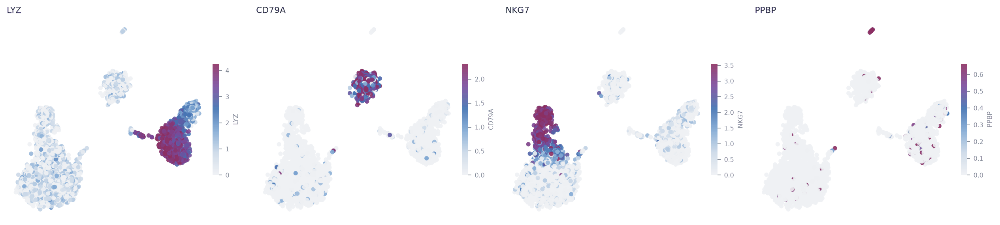
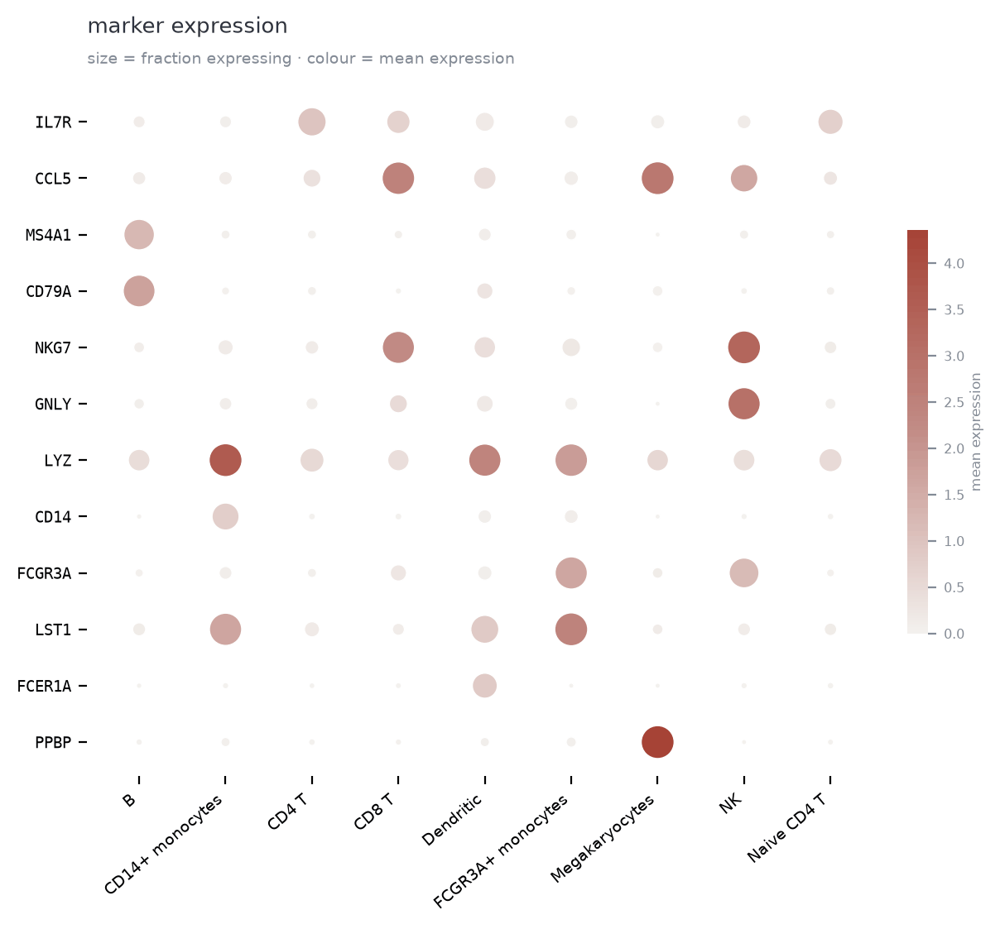

# Plotting

Every figure comes from `ps.pl` and needs the `plot` extra
(`pip install "polariseq[plot] @ git+https://github.com/DarkOxygen123/Polariseq.git"`). The figures below
are shown in the default theme and, when GitHub is in dark mode, in the dark theme
(`ps.pl.set_theme("dark")`).

## Gene expression on the embedding

<p align="center">
  <picture>
    <source media="(prefers-color-scheme: dark)" srcset="assets/genes_dark.png">
    
  </picture>
</p>

```python
ps.pl.umap(adata, color=["LYZ", "CD79A", "NKG7", "PPBP"], ncols=4)
```

## Marker genes by cell type

<p align="center">
  <picture>
    <source media="(prefers-color-scheme: dark)" srcset="assets/dotplot_dark.png">
    
  </picture>
</p>

```python
ps.pl.dotplot(adata, markers, groupby="cell_type")
```

## Every plot type

| kind | functions |
|---|---|
| embeddings | `umap`, `pca`, `embedding`, `compare_analyses` |
| genes and groups | `dotplot`, `heatmap`, `violin`, `rank_genes_groups`, `stacked_bar`, `cluster_sizes` |
| conditions | `volcano`, `fold_changes` |
| quality control | `qc_distributions`, `scatter_qc`, `highly_variable_genes`, `pca_variance_ratio`, `scrublet_score_distribution` |
| whole run | `overview`: QC, PCA, clusters and UMAP from every cell, drawn as density above a million cells |

[`examples/04_plotting.py`](../examples/04_plotting.py) draws each of them and builds multi-panel figures.

## Themes

`ps.pl.set_theme(name)` sets the look of every later figure; `with ps.pl.theme(name):` sets it for a
block of code. Sizes and colours can be overridden, for example
`ps.pl.set_theme("dark", point_scale=2.0, dpi=200)`.

| theme | for |
|---|---|
| `paper` | the default: journal figure sizes |
| `notebook` | larger text for notebooks and screens |
| `talk` | slides |
| `dark` | dark backgrounds |
| `print` | printing: black text, heavier lines, 600 dpi |
| `classic` | the look of Polariseq 0.2.0 and before |
